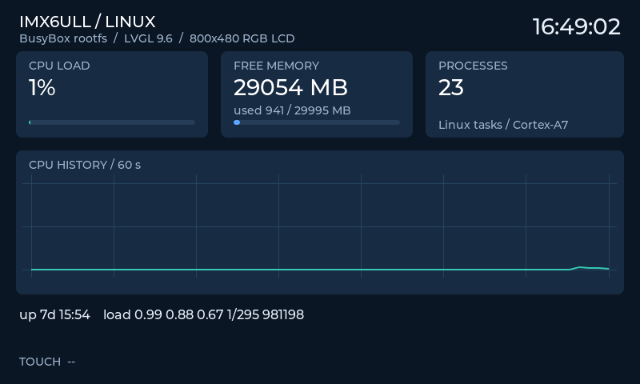

# imx6ull-mini-lvgl

正点原子 **i.MX6ULL Mini** + ATK-4.3 RGBLCD（800×480）上的 **LVGL 9.6.0** 全屏仪表盘。

不依赖 X11 / Wayland / Qt：直接 `mmap` `/dev/fb0` 刷屏，直接读 `/dev/input/event*` 取触摸，
静态链接后连 glibc 一起进 initramfs。产物 `lvgl_demo` 约 **849 KB**。



## 快速开始

```bash
sudo apt install build-essential gcc-arm-linux-gnueabihf
git clone https://github.com/xuliyan0099/imx6ull-mini-lvgl.git
cd imx6ull-mini-lvgl
bash tools/build.sh                       # 自动拉 LVGL v9.6.0 再交叉编译
# 或者手动：make static CC=arm-linux-gnueabihf-gcc STRIP=arm-linux-gnueabihf-strip LVGL_DIR=$PWD/vendor/lvgl
```

主机端预览（不需要板子）：`make preview`，产出 `preview.png`（假 framebuffer、无触摸）。

`LVGL_DIR` 默认 `./vendor/lvgl`，也可指向任意 LVGL 9.6 源码树。

## 界面内容

- 顶栏：`IMX6ULL / LINUX`、当前时间
- 三张卡：CPU 占用（`/proc/stat` 差值 + 指数平滑）、空闲内存（`/proc/meminfo` MemAvailable）、进程数（`/proc` 数字目录计数）
- CPU 60 秒历史曲线（1 秒一个点）
- 底部：uptime、`/proc/loadavg`、触摸坐标与设备名
- 配色：背景 `0x0b1625`、卡片 `0x172b42`、青 `0x36c8b3`、蓝 `0x5ca7ff`

## 代码结构

| 文件 | 职责 |
| --- | --- |
| `src/main.c` | `lv_init()`、tick、主循环 `lv_timer_handler()` |
| `src/display.c` | `mmap` `/dev/fb0`，读 `FBIOGET_VSCREENINFO`，40 行分块 flush；XRGB8888 直拷，16bpp 转 RGB565 |
| `src/input.c` | 扫 `/dev/input/event0..9` 找带 `ABS_X/ABS_Y` 的设备，`EVIOCGABS` 原始范围映射 |
| `src/ui.c` | 800×480 布局与 `/proc` 数据采集 |
| `config/lv_conf.h` | 4 MB 内存池、`LV_COLOR_DEPTH 32`、Montserrat 14/16/20/28 |

## 运行

```sh
/usr/bin/lvgl_demo                 # 前台跑
killall lvgl_demo                  # 停止
LVGL_TOUCH_SWAP=1 /usr/bin/lvgl_demo                     # 触摸方向修正
LVGL_TOUCH_INVERT_X=1 LVGL_TOUCH_INVERT_Y=1 /usr/bin/lvgl_demo
```

rootfs 侧的开机自启在 `imx6ull-mini-busybox-rootfs` 的 `rootfs/etc/init.d/rcS`（日志 `/var/log/lvgl.log`）。

## 已知限制

- 只带 Montserrat（ASCII），中文要另用 `lv_font_conv` 生成字库。
- 布局写死 800×480；换 480×272 屏需另做紧凑版。
- 纯软件渲染，QEMU 空载约 14% CPU。
- QEMU 的 GT911 模型只暴露单点，界面会显示 `TOUCH 0,0`，真板才有真实坐标。

## 环境变量

| 变量 | 默认 | 用途 |
| --- | --- | --- |
| `IM6_SRC` | `./vendor` | LVGL 源码目录 |
| `IM6_LV_URL` | GitHub 官方仓库 | 内网镜像 |
| `IM6_CROSS` | `arm-linux-gnueabihf-` | 交叉前缀 |
| `LVGL_DIR` | `./vendor/lvgl` | 直接给 Makefile 用 |

许可：本仓库应用代码 MIT；LVGL 本体 MIT。
